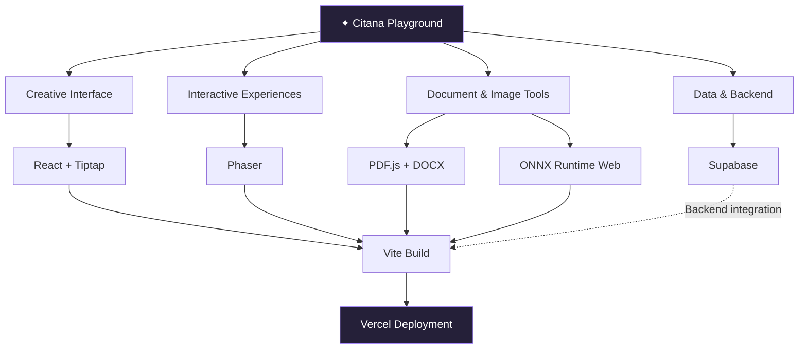

<h1 align="center", style="letter-spacing: 4px; font-family: 'Inter; margin: 10px;'">
  CITANA PLAYGROUND
</h1>

<p align="center">
  <a href="https://citana-playground.vercel.app/">
    
  </a>
  <a href="https://github.com/reamura87/Citana-Playground">
    
  </a>
</p>

<p align="center">
  
  
  
  
</p>

---

> *Somewhere between a random thought and a finished creation, there is a playground.*

**Citana Playground** is a personal digital garden for experimenting, building, and collecting ideas. It is a space where code meets creativity, small experiments become projects, and curiosity has room to grow.

Rather than being just another portfolio, Citana is an evolving collection of digital tools, creative experiments, and things worth exploring.

## ◈ The Philosophy

A playground should never feel finished.

It should be a place to try something unusual, make mistakes, discover new possibilities, and turn a random idea into something real.

Citana is built around three simple principles:

- **Explore** — follow curiosity and experiment with new ideas.
- **Create** — turn thoughts into interactive digital experiences.
- **Collect** — keep useful creations and interesting discoveries in one place.

## ✧ Explore the Playground

<p align="center">
  
  
  
  
</p>

<p align="center"><i>A glimpse into a growing collection of digital experiments.</i></p>

| Space | Description |
|---|---|
| ✎ Creative Writing | A rich-text editing experience for writing and shaping ideas. |
| ◈ Image Experiments | Explore image workflows, including browser-based background removal. |
| ▧ Document Lab | Experiment with document processing and PDF-to-Word workflows. |
| ✦ Interactive Experiments | A space for exploring interactive experiences and game-like ideas. |
| ⌘ Developer Playground | A growing collection of web experiments and personal projects. |

*The spaces above describe the project's intended creative direction and capabilities represented by its current dependencies; availability and completeness may vary as development continues.*

## ⌘ Built With

<p align="center">
  
</p>

| Technology | Role |
|---|---|
| React | Component-based user interface |
| Vite | Development server and build tooling |
| React Router | Client-side navigation |
| Supabase | Backend services and database integration |
| Tiptap | Rich-text editor foundation |
| Phaser | Interactive game development |
| ONNX Runtime Web | Browser-based machine learning inference |
| PDF.js & DOCX | Document rendering and Word document workflows |
| Vercel | Website deployment |

## ◉ How It Works



The frontend is built with React and Vite. Specialized libraries support editing, document handling, image processing, and interactive experiences. Supabase provides the foundation for backend integration, while Vercel hosts the deployed website.

## ⌘ Run Locally

Want to explore the project or experiment with the source code?

### Prerequisites

- [Node.js](https://nodejs.org/)
- npm
- Git

### Installation

```bash
# Clone the repository
git clone https://github.com/reamura87/Citana-Playground.git

# Enter the project directory
cd Citana-Playground

# Install dependencies
npm install

# Start the development server
npm run dev
```

Vite will display a local URL in your terminal, usually `http://localhost:5173`.

### Available Commands

| Command | Description |
|---|---|
| `npm run dev` | Start the development server |
| `npm run build` | Build the production application |
| `npm run preview` | Preview the production build |
| `npm run lint` | Run ESLint |

### Environment Variables

If a feature requires Supabase or another external service, configure its environment variables using the project's expected names.

Create a local `.env` file and use `.env.example` as a reference if it documents the required variables.

**Never commit real API keys, passwords, access tokens, or private credentials.** Only expose public client-side credentials intended for browser use. Enforce authorization and data access policies on the backend.

## ◈ Project Structure

```text
Citana-Playground/
├── public/             # Static assets
├── src/                # Application source code
├── .github/            # GitHub workflows
├── .env.example        # Environment template, if applicable
├── .gitignore
├── index.html
├── package.json
├── vite.config.js
├── vercel.json
└── README.md
```

This is a high-level overview of the repository. Additional components, routes, and modules may exist within `src/`.

## ✧ Roadmap

The playground is an evolving project. Potential directions include:

- [ ] Refine the creative digital garden aesthetic.
- [ ] Expand the collection of browser-based creative tools.
- [ ] Improve the image and document processing experience.
- [ ] Develop more interactive experiments and small games.
- [ ] Improve accessibility, responsiveness, and performance.
- [ ] Document individual experiments and their implementation.
- [ ] Add screenshots and demonstrations for each major feature.

## ◈ Contributing

Ideas, feedback, and improvements are welcome.

1. Fork the repository.
2. Create a feature branch.
3. Make your changes.
4. Run the build and lint checks.
5. Open a pull request describing your contribution.

For larger changes, consider opening an issue first to discuss the idea.

## ✦ A Little More About This Project

Citana Playground is an independent creative project built through curiosity, experimentation, and continuous learning.

It is not just about what can be built today. It is about leaving room for what might be built tomorrow.

If you find something interesting here, explore the source, share your feedback, or follow along as the playground grows.

<p align="center">
  <a href="https://citana-playground.vercel.app/">
    
  </a>
</p>

<p align="center">
  <sub>Made with curiosity, a little chaos, and a lot of code.</sub>
</p>
